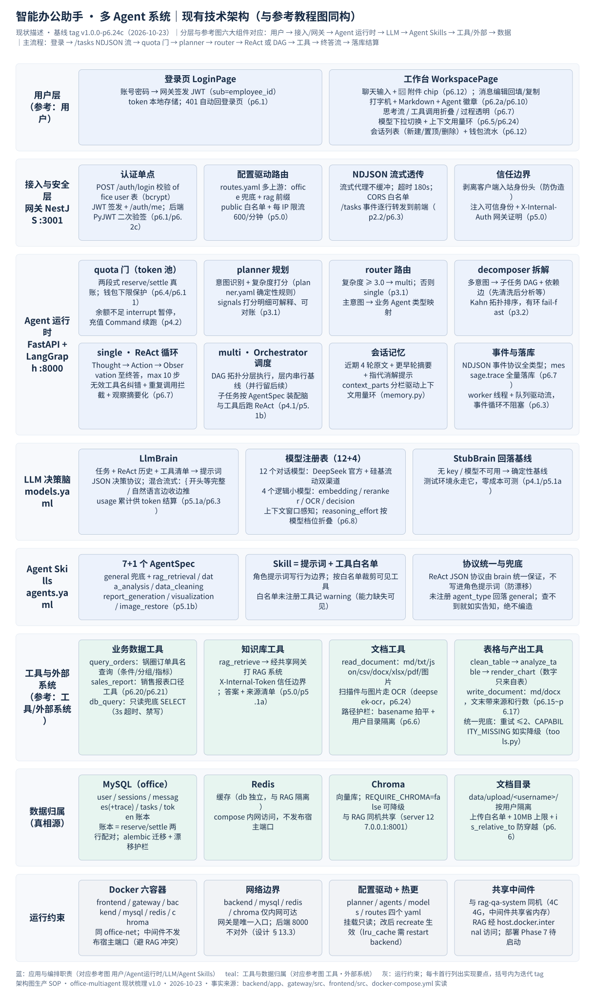
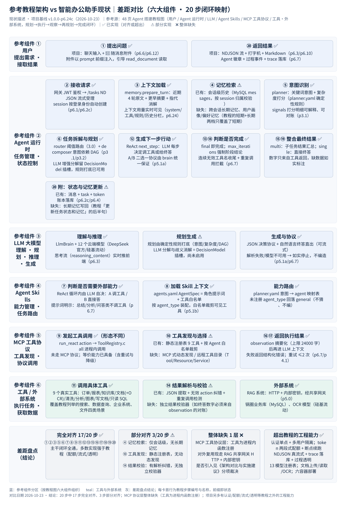

# 智能办公助手 · 架构对比与实施建议

**对比双方**：参考《3.5 小时练完这 48 页 · 你的 Agent 搭建就牛了》教程架构图（下称"参考架构"） × office-multiagent 现状（基线 tag `v1.0.0-p6.24c`，2026-10-23 实读代码）
**用途**：回答三个问题——差多少？有没有必要弄？具体建议是什么？

---

## 一、结论先行

| 问题 | 结论 |
| --- | --- |
| 差多少？ | 参考架构 20 步执行闭环中，**17 步完全对齐、3 步部分对齐（④ 记忆检索、⑩ 工具发现、⑭ 结果校验）**；六大组件中 **MCP 工具协议层整体缺失**（工具以进程内函数注册，未走协议）。主干闭环"规划 → 执行 → 观察 → 再规划 → 完成"已全通。 |
| 有必要照搬吗？ | **不建议整体照搬。** 参考架构是"从零搭一个通用 Agent"的教学骨架，价值是当**验收清单**；你的项目已是带认证、配额、流式、落库的生产形态，工程完整度高于教程。把系统重构成教程的分层是负收益。 |
| 具体建议？ | 真正要补的只有 3 件半：**① 轻量长期记忆（建议做）② 轻量结果校验器（建议做）③ MCP 协议层（暂缓，有明确触发条件再做）**，另有 2 项按需启动（LLM 规划增强、DAG 并行）。详见第六、七节。 |

一句话：**看图觉得差很多，逐行对数只差 3 步半——因为教程画的是"最小闭环"，你建的是"带工程护甲的闭环"。**

---

## 二、参考架构是什么

参考架构图由六类组件和约 20 个步骤组成：

- **六大组件**：用户（提出需求、接取结果）→ Agent 运行时（任务管理、状态控制）→ LLM 大模型（理解、规划、推理、生成）→ Agent Skills（能力管理、任务路由）→ MCP 工具协议（工具发现、协议调用）→ 工具/外部系统（执行任务、获取数据）。
- **20 步闭环**：提出问题 → 接收请求 → 上下文加载 → 记忆检索 → 意图识别 → 任务拆解与规划 → 判断是否需要外部能力 → 加载 Skill 上下文 → 发起工具调用 → 工具发现与选择 → 调用具体工具 → 生成下一步行动 → 判断是否完成（未完成则重新规划）→ 结果解析与校验 → 整合最终结果 → 返回执行结果 → 再次判断 → 整合 → 返回结果并更新任务状态和记忆。
- **核心逻辑**：AI Agent 通过理解用户需求，结合上下文和记忆进行任务规划，基于合适的 Skill 调用外部工具，根据执行结果不断观察与反思、动态调整计划，最终生成可靠答案并完成任务。

它回答的问题是："一个自主 Agent 从收到请求到交付结果，中间必须经过哪些环节"。

---

## 三、项目现状速览（分层事实）

| 层 | 组件（端口） | 关键实现 | 对应参考组件 |
| --- | --- | --- | --- |
| 用户层 | 前端 React（8080） | 登录页 + 工作台；聊天输入+附件；打字机+Markdown+Agent 徽章；模型切换+上下文环；会话管理+钱包流水 | 用户 |
| 接入与安全层 | 网关 NestJS（3001） | JWT 认证单点（sub=employee_id）；routes.yaml 配置驱动路由+限流；NDJSON 流式透传；身份头剥离/注入（信任边界） | （教程未涉及） |
| Agent 运行时 | 后端 FastAPI+LangGraph（8000 内网） | quota 门（reserve/settle 两段式+断点续跑）；planner 意图+复杂度；router 路由；decomposer DAG；ReAct 循环；Orchestrator 分层调度；会话记忆；NDJSON 事件+trace 落库 | Agent 运行时 |
| LLM 决策脑 | models.yaml | LlmBrain（JSON 决策协议+混合流式）；12 个对话模型（DeepSeek 官方/硅基流动双渠道）+4 个逻辑小模型；StubBrain 回落基线 | LLM 大模型 |
| 角色能力池 | agents.yaml | 7+1 个 AgentSpec（角色提示词+工具白名单）；未注册回落 general | Agent Skills |
| 工具与外部 | 9 个真实工具 | query_orders / sales_report / db_query / rag_retrieve / read_document（含 OCR）/ clean_table / analyze_table / render_chart / write_document；统一重试与 CAPABILITY_MISSING 降级 | 工具/外部系统（经进程内注册，非 MCP） |
| 数据归属 | MySQL / Redis / Chroma / 文档目录 | 用户/会话/消息(+trace)/任务/token 账本；缓存；向量库；按用户隔离的上传目录 | （教程未涉及） |
| 运行约束 | Docker 六容器 | office-net 内网；网关唯一入口；中间件与 RAG 同机共享 | （教程未涉及） |

---

## 四、20 步闭环逐项对比

| 步骤 | 参考架构环节 | 项目实现（代码/迭代） | 状态 |
| --- | --- | --- | --- |
| ① | 提出问题 | 聊天输入 + 📎 随消息附件，prompt 前缀注入（p6.12） | ✅ |
| ② | 接收请求 | 网关 JWT 鉴权 → /tasks NDJSON 流式受理；session 按身份自动创建（p6.1/p6.2c） | ✅ |
| ③ | 上下文加载 | memory.prepare_turn：近期 4 轮原文+更早摘要+指代消解；用量分栏实时可见（p6.24） | ✅ |
| ④ | 记忆检索 | 仅有会话级历史（MySQL messages）；**无跨会话长期记忆、无用户画像** | ⚠️ |
| ⑤ | 意图识别 | planner：关键词意图+复杂度打分，signals 可解释（planner.yaml，p3.1） | ✅ |
| ⑥ | 任务拆解与规划 | router 阈值路由 + decomposer 意图依赖 DAG（p3.1/p3.2） | ✅ |
| ⑦ | 判断是否需要外部能力 | ReAct 循环内 LLM 自决（A 调工具/B 直接答，p6.7） | ✅ |
| ⑧ | 加载 Skill 上下文 | agents.yaml AgentSpec = 角色提示词+工具白名单（p5.1b） | ✅ |
| ⑨ | 发起工具调用 | run_react action → ToolRegistry.call（进程内，含重试≤2） | ✅ 形态不同 |
| ⑩ | 工具发现与选择 | 静态注册表 9 工具+按 Agent 白名单裁剪；**无动态发现** | ⚠️ |
| ⑪ | 调用具体工具 | 订单/报表/知识库/文档(+OCR)/清洗/分析/图表/写文档/只读 SQL | ✅ |
| ⑫ | 生成下一步行动 | ReAct next_step：LLM 每步决策（p5.1a） | ✅ |
| ⑬⑱ | 判断是否完成 | final 即完成；超限强制结论；连续无效工具名收尾；重复调用拦截（p6.7） | ✅ |
| ⑭ | 结果解析与校验 | JSON 提取+无效 action 纠错+重复检测；**无独立结果校验器** | ⚠️ |
| ⑮⑲ | 整合最终结果 | multi 子任务汇总；single 直接终答；数字只来自工具 | ✅ |
| ⑯⑰ | 返回执行结果 | observation 摘要化（上限 24000 字）再进上下文（p6.7/p6.9） | ✅ |
| ⑳ | 返回结果+更新状态 | NDJSON 流+打字机；消息/task/token 账本落库；**长期记忆写回缺失** | ✅ 大半 |
| — | MCP 协议层 | 无；对外复用走 RAG 共享网关 HTTP+内部密钥（已跑通） | ❌ 整层 |

---

## 五、差距实质分析

### 5.1 ⚠️ ④ 记忆检索：只有"短期"，没有"长期"

项目有会话级记忆（近期 4 轮原文+更早轮摘要+指代消解），对应教程的"短期记忆"；缺的是"长期记忆/用户相关信息"——跨会话记住用户的部门、常用口径（如"月报按下单时间"）、偏好输出格式。对办公助手这是**真实价值点**：同一用户天天来问报表，每次重述口径是浪费。

### 5.2 ⚠️ ⑩ 工具发现与选择：静态注册表

项目工具在 `build_default_registry` 静态注册（9 个），Agent 按 agents.yaml 白名单可见。这不是缺陷而是**刻意的可控性选择**：动态发现会让"Agent 能看到什么"变成运行时不确定，与项目 fail-closed 纪律冲突。工具增长时改 yaml 即可，当前规模（9 个）没有发现瓶颈。

### 5.3 ⚠️ ⑭ 结果解析与校验：有解析纠错，无独立校验

项目已有 JSON 提取、无效工具名纠错（p6.7）、重复调用拦截——这些是"解析"层的防护。缺的是"校验"层：终答里的数字是否真的来自工具观察。目前靠提示词纪律（"数字只使用工具返回的结果，绝不编造"），没有机器可验的闸门。

### 5.4 ❌ MCP 协议层：整体缺失，但影响有限

MCP 的价值在**跨系统工具互通**（工具发现、协议调用、给第三方 Agent 消费）。项目当前形态：单租户内部办公系统，工具自建自用，对外复用（RAG）已走"共享网关 HTTP+内部密钥"跑通。缺 MCP 不影响任何现有功能，只影响未来的互操作性。

### 5.5 项目已超出教程的部分（是盈余，不是差距）

认证单点与多用户隔离、token 两段式配额+断点续跑、NDJSON 真流式+打字机、trace 落库+过程透明、12 模型注册表与双渠道、文档上传/读取/OCR、六容器部署——这些教程都没画，但它们是"能给真实用户用"和"只能演示"的分界线。

---

## 六、分项裁决：是否有必要弄图中的架构

| 参考组件/能力 | 项目现状 | 裁决 | 理由与触发条件 |
| --- | --- | --- | --- |
| MCP 工具协议层 | 缺失 | **暂缓 ❌** | 内部系统+工具已稳定+白名单可控，三者叠加下 MCP 边际价值低。**触发条件**：要把工具开放给第三方 Agent 消费，或要接入外部 MCP 生态工具。届时把 ToolRegistry 的描述序列化包一层 MCP server 即可（工具元数据已在），估 1-2 天。 |
| 长期记忆（④ 后半） | 缺失 | **建议做 ✅（轻量）** | 办公场景价值直接（口径/偏好/部门跨会话复用）。先做"显式记忆"：user_memory 表（user_id/key/value/来源/时间），检索后注入 context_parts.memory；支持用户查看和删除。**不做**自动静默抽取（脏数据进上下文比没有记忆更糟）。 |
| 动态工具发现（⑩） | 静态 | **不做 ❌** | 见 5.2；与 fail-closed 冲突，收益不确定。 |
| 结果校验/反思（⑭） | 部分 | **建议做 ✅（轻量）** | 规则校验器：终答中出现的数字若未在任何 observation 中出现 → 打标并要求重写或降级表述。机器可验、直击"编造"这个最大风险，与现有"绝不编造"纪律形成最后一道闸。 |
| LLM 规划增强（DecisionModel 插槽） | 未启用 | **按需 ⏸** | 规则已覆盖 6 意图+DAG；等真实流量出现误路由案例，先用 planner.yaml 调阈值/关键词，仍不足再启用插槽。 |
| DAG 层内并行 | 串行基线 | **按需 ⏸** | 接口已按层组织好，改 asyncio.gather 约 0.5 天；等出现"多子任务慢"的真实投诉再做。 |
| 其余 17 步 | 已对齐 | **无需动作** | 作为回归基线保持。 |

---

## 七、落地建议（优先级/工作量/验收）

| 优先级 | 事项 | 工作量估计 | 验收标准 |
| --- | --- | --- | --- |
| P1 | 轻量结果校验器（react.py 终答前对账） | 1 天 | 测试：含未溯源数字的终答被拦截/打标；正常终答零误伤（回归 146+ pytest 全绿） |
| P1 | 显式长期记忆（user_memory 表+注入+设置页查看/删除） | 2-3 天 | 跨会话 recall 命中注入上下文；用户可删除；不注入时行为与现在完全一致（开关默认关或空表无感） |
| P2 | MCP server 封装（仅当有外部消费方） | 1-2 天 | 第三方客户端能列出 9 工具并调用成功；内部链路不回退 |
| P2 | DAG 层内并行（有性能投诉时） | 0.5 天 | 多子任务总耗时下降；事件 seq 仍单调（主 emitter 纪律不变） |
| P3 | LLM 规划增强（误路由案例积累后） | 2-3 天 | 误路由率下降；规则基线可一键回落 |
| — | 动态工具发现 | 不建议 | — |

**顺序建议**：先做 P1 两项（都轻、都直击风险/价值），其余全部挂"触发条件"，不抢 Phase 7 部署和管理端的时间。

---

## 八、如何使用这两张图

- **图 1《项目现有技术架构》**：与参考图同构（用户→网关→Agent 运行时→LLM→Agent Skills→工具/外部→数据），可逐层对照参考图找对应物；每卡括号内是迭代 tag，可回溯到 docs/iterations/。
- **图 2《参考架构差距对比》**：按参考图六大组件分区、20 步编号映射，✅/⚠️/❌ 直接回答"差多少"。
- **把参考图当 checklist**：今后每加一个新能力（如联网搜索、邮件发送），先对照 20 步看它落在哪一步、是否引入了新的断点，再动手。

---

## 附：交付物

| 文件 | 内容 |
| --- | --- |
| 01-办公多Agent系统-技术架构.svg / .png | 图 1：项目现有技术架构（与参考图同构） |
| 02-参考架构差距对比.svg / .png | 图 2：20 步闭环差距映射 |
| 办公多Agent系统-架构对比与实施建议.md / .html | 本文（含实施建议） |
| 视图需求.json / 交付清单.json | 技能交付契约记录 |
